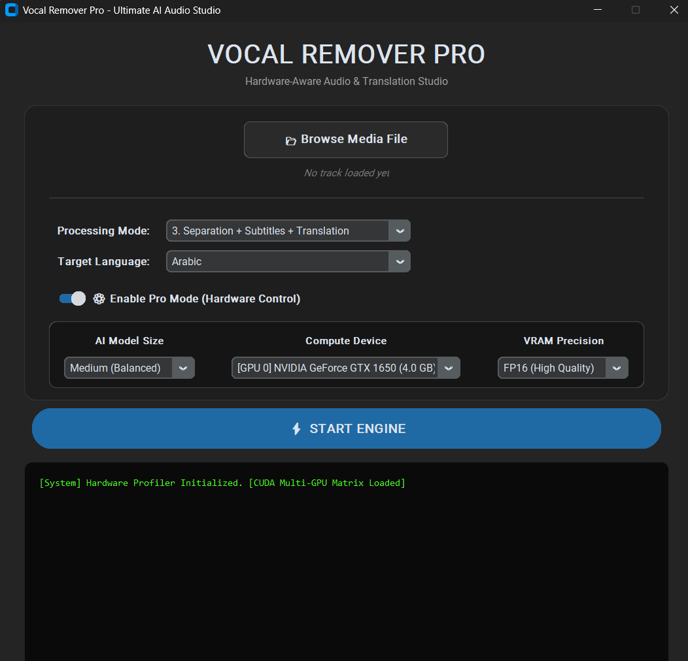

# Vocal Remover Pro 🎵🎙️

An end-to-end, hardware-aware desktop workstation engineered for neural audio source separation, automated speech-to-text subtitling, and multilingual neural translation.

---

## 📸 Application Preview

---

## ⚡ Key Architecture & Features

### 1. High-Fidelity Audio Separation
* Powered by Meta AI's Demucs (htdemucs) Hybrid Transformer architecture.
* Isolates clean vocal stems and instrumental backings with minimal phase distortion.

### 2. Synchronized Speech Transcription
* Integrated with Faster-Whisper (CTranslate2 reimplementation of OpenAI's Whisper model).
* Delivers up to 4x inference speedup with INT8 and FP16 quantization support.
* Generates synchronized time-coded .srt subtitle files with dynamic language detection.

### 3. Neural Sequence-to-Sequence Translation
* Implements Meta AI's NLLB-200 (No Language Left Behind) distilled core.
* Translates isolated vocal transcriptions across multiple target languages while preserving exact subtitle time stamps.

### 4. Hardware-Aware Resource Guard
* Dynamic VRAM Profiling: Scans system GPUs via PyTorch CUDA bindings, dynamically allocating memory boundaries.
* OOM Crash Prevention: Proactively blocks execution if the model footprint exceeds available GPU VRAM.
* Full CPU Fallback: Automatic architectural fallback to multi-threaded CPU execution when no CUDA GPU is detected.

### 5. Multi-Track Media Multiplexing
* FFmpeg pipeline automation to mux video, isolated audio stems, and soft subtitles directly into MKV containers.

---

## 📊 Pipeline Overview

* Step 1 (Demucs): Media Input -> Stem Separation (Vocals & Instrumentals).
* Step 2 (Faster-Whisper): Vocals -> Automatic Speech Recognition & Synced Subtitles (.srt).
* Step 3 (Meta NLLB-200): Source Subtitles -> Neural Sequence Translation (.srt).
* Step 4 (FFmpeg Multiplexer): Video + Audio Stems + Multi-language Subtitles -> Master MKV Container.

---

## 🛠️ Tech Stack

* Language: Python 3.10+
* GUI Engine: CustomTkinter
* AI & Neural Frameworks: PyTorch, Demucs, Faster-Whisper, HuggingFace Transformers, SentencePiece
* Media Handling: FFmpeg, PySRT

---

## 🚀 Installation & Setup

### Prerequisites
* Python 3.10 or higher.
* FFmpeg installed and added to system PATH.
* NVIDIA GPU with CUDA support recommended (CPU fully supported).

### 1. Clone Repository
git clone https://github.com/abdessalam-zenkoufi/vocal-remover-pro.git
cd vocal-remover-pro

### 2. Create Virtual Environment
Windows:
python -m venv venv
venv\Scripts\activate

Linux / macOS:
python3 -m venv venv
source venv/bin/activate

### 3. Install PyTorch with CUDA
pip install torch torchvision torchaudio --index-url https://download.pytorch.org/whl/cu121

### 4. Install Requirements
pip install -r requirements.txt

---

## 🖥️ Running the Application

python main.py

---

## 📁 Repository Structure

vocal-remover-pro/
├── assets/
│   └── demo.png
├── main.py
├── requirements.txt
├── .gitignore
├── LICENSE
└── README.md

---

## 📄 License
Distributed under the MIT License. See LICENSE for more information.